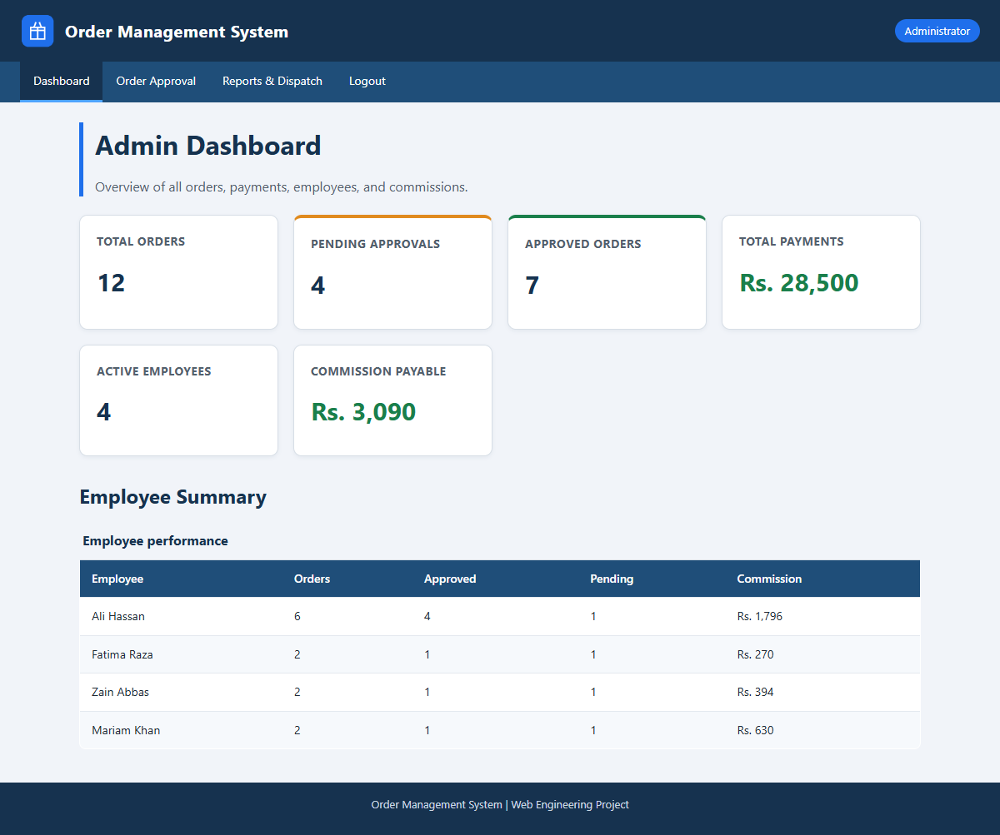
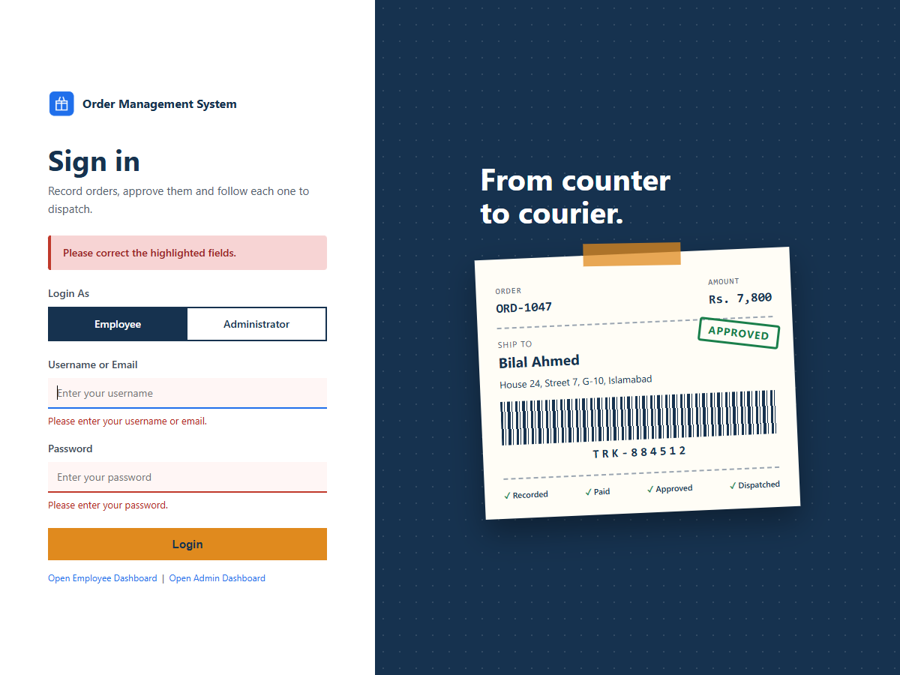
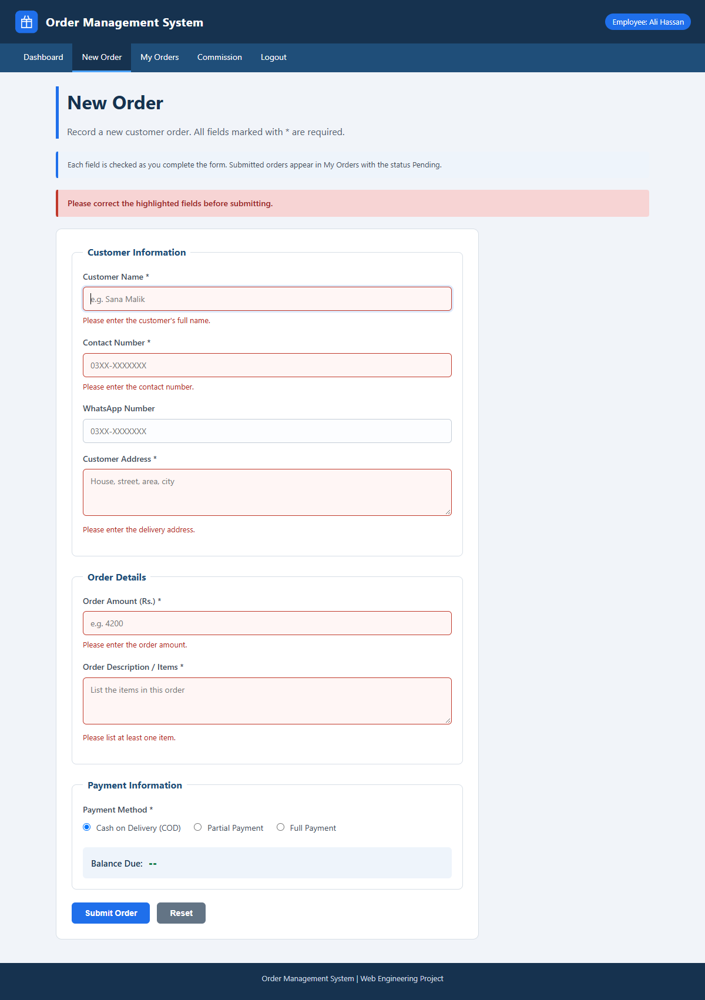
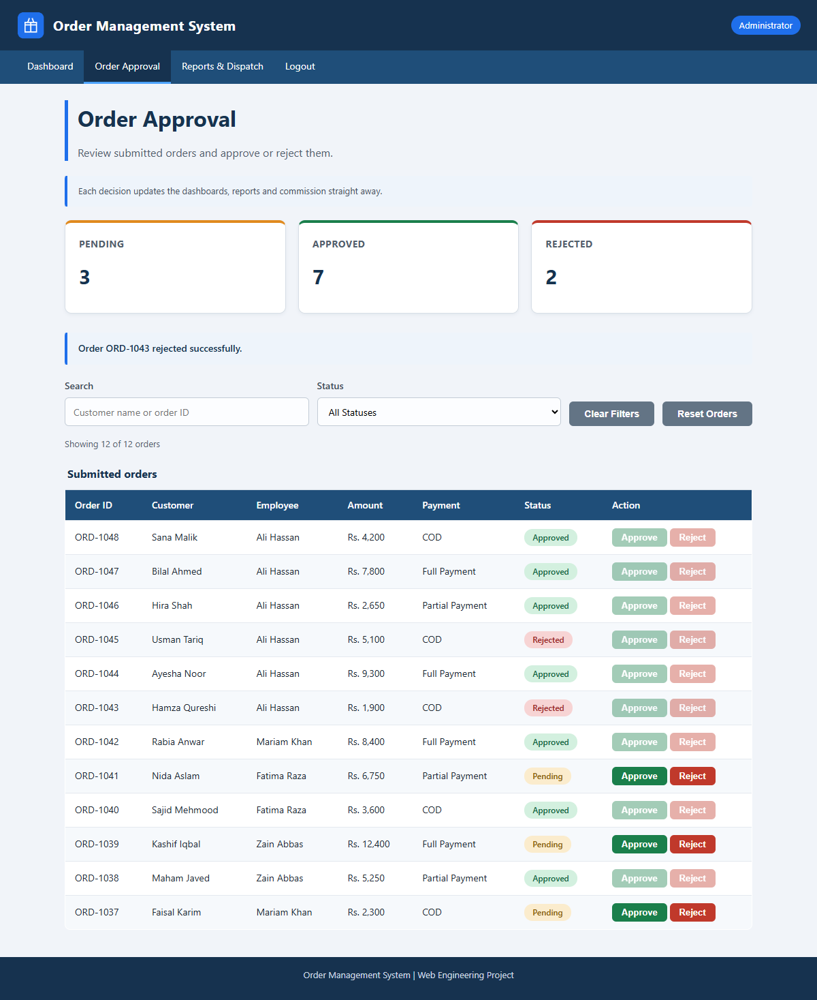
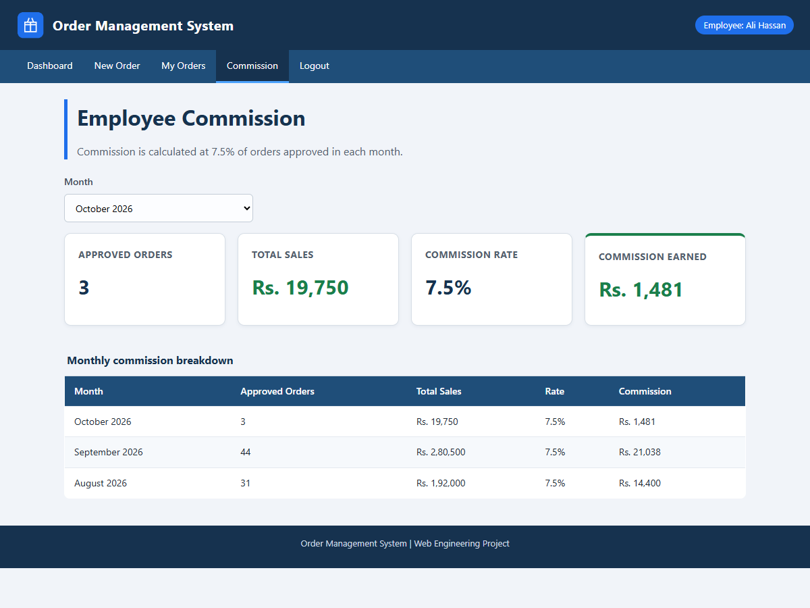

# Order Management System

A browser-based application for recording customer orders, tracking payments, approving orders, and calculating employee commission. It is built with HTML5, CSS3, and vanilla JavaScript, and has no frameworks or build tools.

**Live site:** [taimourmushtaq.github.io/Web-Engineering-Semester-Project-26](https://taimourmushtaq.github.io/Web-Engineering-Semester-Project-26/)



## Overview

The system supports two roles. Employees enter orders and follow their progress. Administrators review those orders and monitor overall activity. Dashboards, tables, and commission figures are all calculated from the order data, so they update as soon as an order changes.

This project was developed for the Web Engineering course at Federal Urdu University of Arts, Science and Technology, Islamabad. The current release covers the client side of the system. Server-side programming, database connectivity, and real user authentication belong to later phases.

## Features

### Employee

- Create orders with validation messages shown beside each invalid field
- Choose Cash on Delivery, Partial Payment, or Full Payment, with the form adjusting to the selected method
- See the balance due update while typing
- Search and filter personal orders
- View a dashboard and a monthly commission summary

### Administrator

- Approve or reject pending orders, with status and counters updating without a page reload
- Search all orders by customer name or order ID, and filter by status
- Monitor orders, payments, employee performance, and commission payable from the dashboard
- View dispatch figures calculated from approved orders

### Across the application

- Orders and approval decisions saved in the browser with `localStorage`
- Styled on-page messages in place of browser alert boxes
- A Reset Orders option that restores the original order list

## Business Rules

| Rule | Behaviour |
| --- | --- |
| Cash on Delivery | Amount received is 0, and no receipt is required |
| Partial Payment | Amount received is greater than 0 and less than the order amount, and a receipt is required |
| Full Payment | Amount received equals the order amount, and a receipt is required |
| Payment receipt | JPG, PNG, or PDF file of up to 5 MB |
| Balance due | Order amount minus amount received |
| Order status | Can change only from Pending to Approved or from Pending to Rejected |
| Commission | 7.5% of approved sales, counted in the month of approval |

## Screenshots

| Login | New Order validation |
| --- | --- |
|  |  |

| Order approval | Commission |
| --- | --- |
|  |  |

## Getting Started

The application has no dependencies. Use the [live site](https://taimourmushtaq.github.io/Web-Engineering-Semester-Project-26/), or run it locally:

```bash
git clone https://github.com/TAIMOURMUSHTAQ/Web-Engineering-Semester-Project-26.git
cd Web-Engineering-Semester-Project-26
```

Then open `index.html` in a browser. To serve it over HTTP instead:

```bash
python -m http.server 8000
```

The site will be available at `http://localhost:8000`.

### Signing in

This release has no backend, so there are no stored accounts. Select a role, then enter any username and password. The login form checks that both fields are filled in and that any email address is correctly formatted.

## Project Structure

```text
.
├── index.html               Login
├── employee-dashboard.html  Employee overview
├── new-order.html           Order entry form
├── my-orders.html           Employee order list
├── commission.html          Monthly commission summary
├── admin-dashboard.html     Administrator overview
├── approvals.html           Approve or reject orders
├── reports-dispatch.html    Reports and dispatch figures
├── css/
│   └── style.css            Shared stylesheet
├── js/
│   ├── common.js            Order data, storage, calculations, shared UI helpers
│   ├── login.js             Login validation and role redirect
│   ├── new-order.js         Form validation, payment fields, balance calculation
│   ├── orders.js            Order tables, search, filter, approve and reject
│   ├── dashboard.js         Dashboard and report figures
│   └── commission.js        Commission summary and month selector
├── design/                  Figma plugin source for the interface designs
├── docs/                    Entity relationship diagram, design previews, document sources
├── images/                  Logo
└── screenshots/             Application screenshots
```

## Current Limitations

- **Authentication:** the login form validates input only and does not verify credentials.
- **Data storage:** orders are saved in the local browser, so they are not shared between users or devices.
- **Employee view:** the employee pages show one employee, Ali Hassan, because sessions require a backend.
- **Receipts:** only the file name is recorded. The file itself is not uploaded.

## Testing

The main workflows were tested with an automated Puppeteer script covering validation, payment rules, approvals, search, filters, dashboards, and commission. All 95 checks passed in Google Chrome and Microsoft Edge with no console errors. The test script is not included in this repository.

## Roadmap

- Server-side application logic
- Database storage for orders, payments, and dispatch records
- User accounts with real authentication and role-based access
